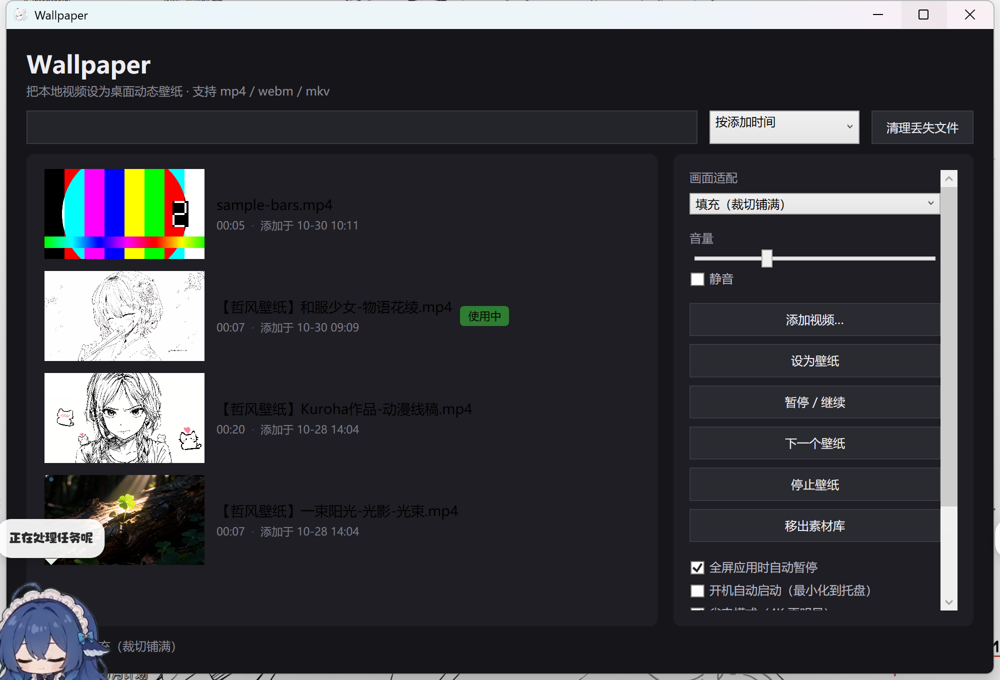
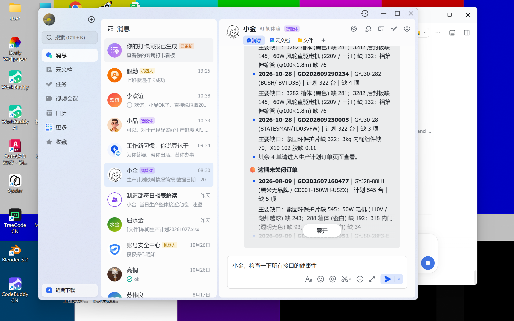

# Wallpaper

把本地视频设为 Windows 桌面动态壁纸的轻量工具。C# + WPF + mpv，无网络、无账号、无后台服务。

[](https://github.com/Rehahaha/Wallpaper/actions/workflows/build.yml)
[](LICENSE)
[](#环境要求)

> 一个「下载了视频，想放到桌面上播」的最小可用实现。MIT 许可。



## 特性

| | |
|---|---|
| 视频壁纸 | 挂在桌面图标层之下，图标、任务栏、开始菜单一切照常 |
| 格式 | mp4 / webm / m4v / mkv，最高 4K |
| 画面适配 | 填充（裁切）、适应（黑边）、拉伸，**运行中实时切换不黑屏** |
| 素材库 | 缩略图、时长自动探测、搜索、排序、丢失文件标记与清理 |
| 自动轮播 | 5 / 15 / 30 / 60 分钟，全屏或暂停时自动跳过 |
| 全屏暂停 | 检测到全屏应用（游戏、全屏视频）自动暂停，退出后恢复 |
| 省电模式 | mpv fast profile，实测 4K60 内存 522 → 349 MB |
| 多显示器 | 每块屏一个宿主窗口 + 独立播放器 |
| 托盘 / 热键 | 关闭窗口进托盘；Ctrl+Alt+W / 空格 / N |
| 容错 | 播放器崩溃自动重启（1s/2s/3s 退避，最多 3 次） |

## 截图

| 素材库 | 桌面效果 |
|---|---|
|  |  |

## 环境要求

- Windows 10 1903+ / Windows 11（x64）
- .NET SDK 10（仅构建需要；分发包自带运行时）
- mpv（运行时依赖，见下）

## 构建

```powershell
# 1) 准备 mpv（约 110 MB，不随仓库分发）
powershell -ExecutionPolicy Bypass -File tools/fetch-mpv.ps1

# 2) 构建
dotnet build Wallpaper.slnx -c Release

# 3) 运行
dotnet run --project src/Wallpaper.App
```

打包成可分发的自包含目录（约 151 MB zip）：

```powershell
powershell -ExecutionPolicy Bypass -File tools/pack.ps1
```

## 使用

1. 点「添加视频…」或把视频拖进窗口
2. 选中素材 →「设为壁纸」（或双击）
3. 按 Win+D 查看桌面

| 快捷键 | 作用 |
|---|---|
| Ctrl+Alt+W | 显示 / 隐藏主界面 |
| Ctrl+Alt+空格 | 暂停 / 继续 |
| Ctrl+Alt+N | 下一个壁纸 |

配置与日志：`%APPDATA%\Wallpaper\`

## 实现笔记（踩过的坑）

这个项目有几条结论和网上流传的做法不一样，记下来给后来人：

### 1. 壁纸层是 Progman 的**子** WorkerW，不是顶层 WorkerW

经典教程是「向 Progman 发 `0x052C`，然后枚举顶层窗口找 WorkerW」。在 Windows 11 build 26200 上，
顶层确实会出现十几个 `WorkerW`，但尺寸都是 131×36 —— 那些是输入法/任务栏相关的窗口。
真正的壁纸层是 **Progman 的子窗口 WorkerW**（全屏、无 `SHELLDLL_DefView` 子窗口）。

### 2. 壁纸层不能用 GDI 画，必须走 D3D 交换链

实测：自己用 GDI 在 WorkerW 里画棋盘格，窗口 `WM_PAINT` 正常触发（计数 3 次），但屏幕上**什么都没有**。
原因是 `Progman` 带 `WS_EX_NOREDIRECTIONBITMAP`，没有 DWM 重定向表面，GDI 内容不参与合成。

| 渲染方式 | 与基线差异 |
|---|---|
| GDI 自绘 | 0%（不可见） |
| mpv `--wid=<WorkerW>` | 96.1% |
| mpv `--wid=<自建宿主窗口>` | 31.8%（正常） |

所以画面必须交给 mpv 的交换链，WPF 只做控制界面。

### 3. 判断「全屏」不能用「覆盖显示器」

最大化窗口的矩形会**超出**显示器边界（Windows 给边框留的透明边，200% 缩放下约 14px）。
用「rect 覆盖 monitor」判断，会让任何最大化的浏览器都被当成全屏，壁纸无故暂停。
正确做法是四边**近似相等**（容差几像素）。

### 4. 不要在 WPF 里对虚拟化列表调 `Items.Refresh()`

`Items.Refresh()` 若恰好落在布局测量过程中，`VirtualizingStackPanel.MeasureChild` 会抛 `NullReferenceException`；
此时再同步弹 MessageBox 会重入布局 → 栈溢出崩溃（`0xc00000fd`）。
改用 `INotifyPropertyChanged` + 延迟到 `ApplicationIdle` 再弹窗。

更多细节见 [docs/M0-notes.md](docs/M0-notes.md) 与 [docs/PRD-MVP.md](docs/PRD-MVP.md)。

## 目录结构

```
src/
  Wallpaper.App/          WPF 界面、托盘、服务编排
  Wallpaper.DesktopHost/  Win32：WorkerW 挂载、全屏检测、全局热键
  Wallpaper.Player/       IVideoPlayer 抽象 + mpv 进程/IPC + 缩略图/时长探测
  Wallpaper.Core/         配置、素材模型、日志
lib/mpv/                  mpv 运行时（自行获取，不入库）
docs/                     需求文档与实践记录
tools/                    打包、验证、获取 mpv 等脚本
```

## 已知限制

- 仅 Windows；macOS / Linux 未实现
- 真实多显示器未在双屏机器上验证过（单屏用 `--simulate-monitors 2` 验证了多会话链路）
- 与 Lively Wallpaper 等其他动态壁纸软件冲突，需只运行一个
- 分发的 exe 未签名，首次运行会有 SmartScreen 提示
- 暂不支持：画面缩放/位移微调、H.265 软解兜底提示

## 许可

本项目源码采用 **MIT**。

运行依赖 [mpv](https://mpv.io/)（GPLv2+），**不包含在本仓库中**。
如果你分发包含 `mpv.exe` 的打包产物，需要同时满足 GPLv2 的要求 —— 详见 [THIRD-PARTY.md](THIRD-PARTY.md)。
